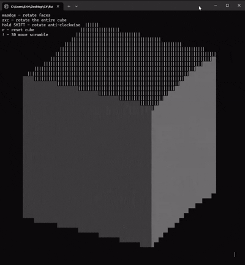

## TUI Rubiks Cube

A rubiks cube visualization running inside a color-less terminal. The different sides are displayed with the 4 different block characters, plus a | and -.

### Usage

Run the program. You will be prompted to change your terminal size to a comfortable resolution. too large will lag the program. After confirming the size you will be shown the cube. using the on-screen help you can rotate and shuffle the cube, or have it auto-shuffled and try to solve it. resetting the cube at any point is availiable.

